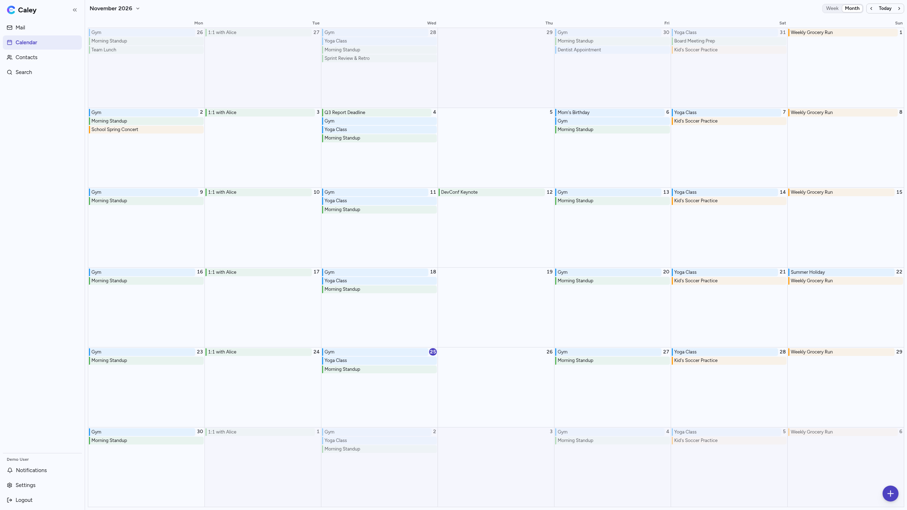
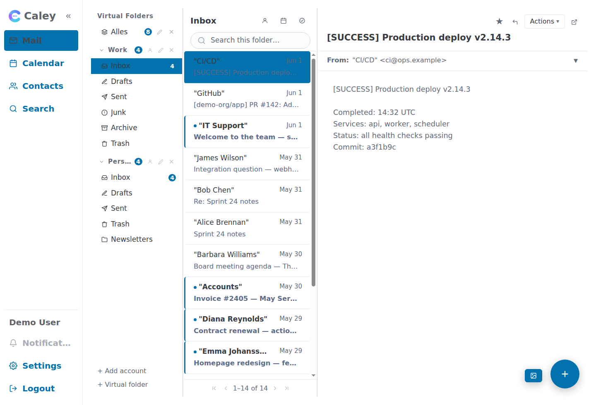
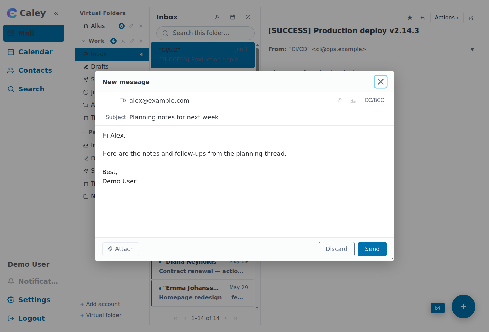
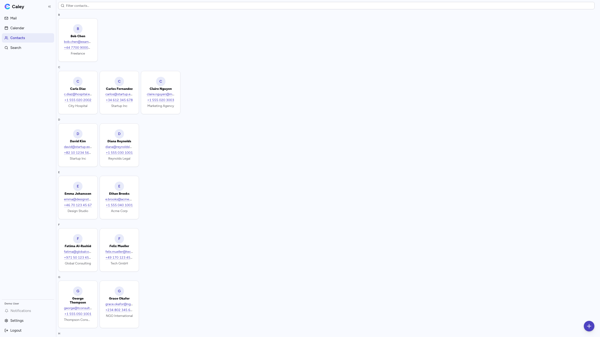
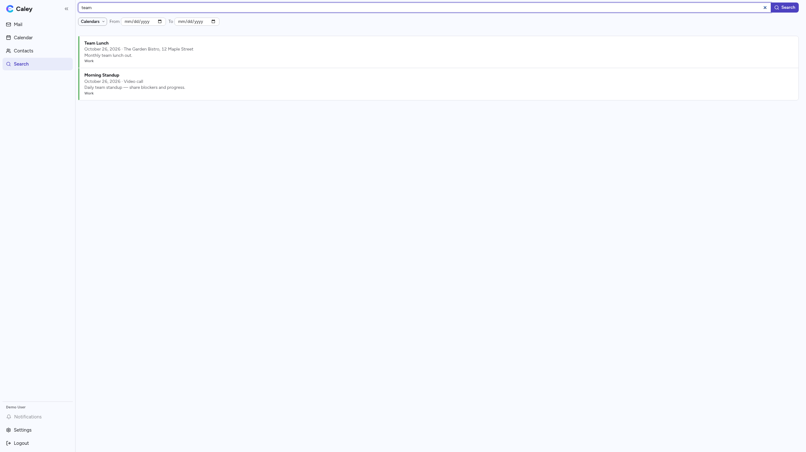
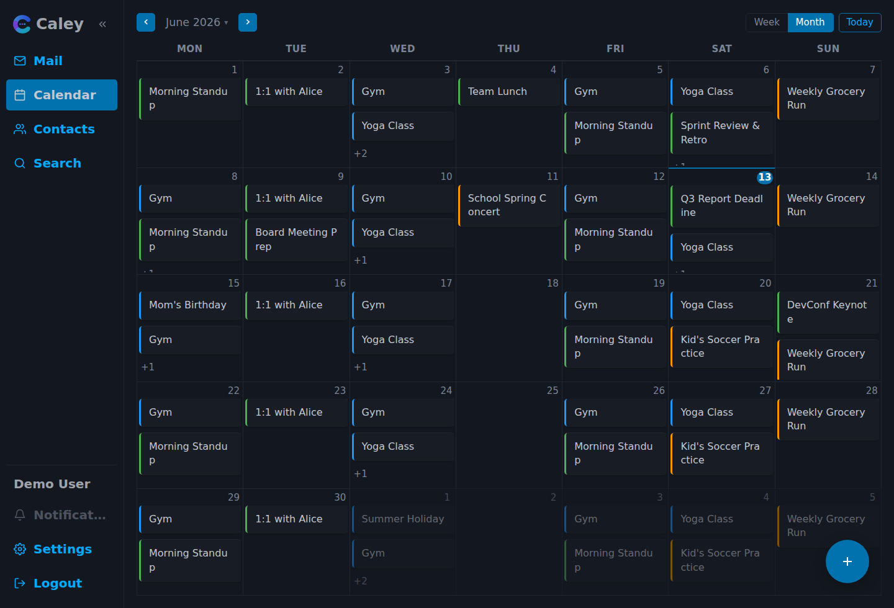
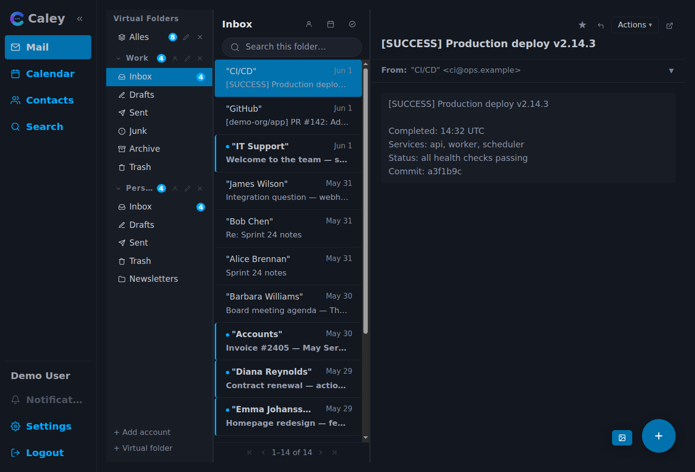
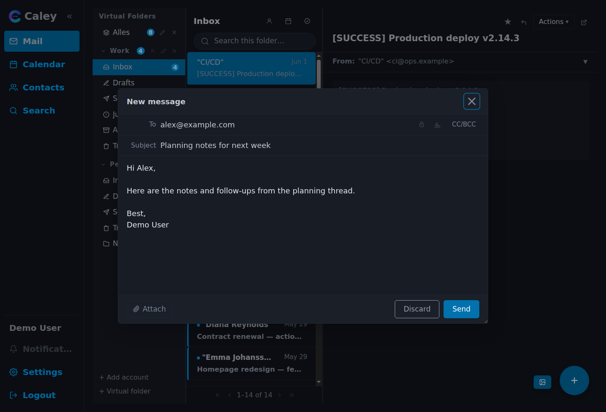
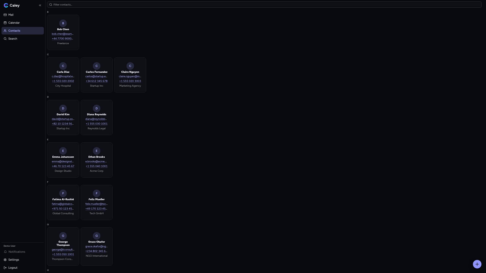
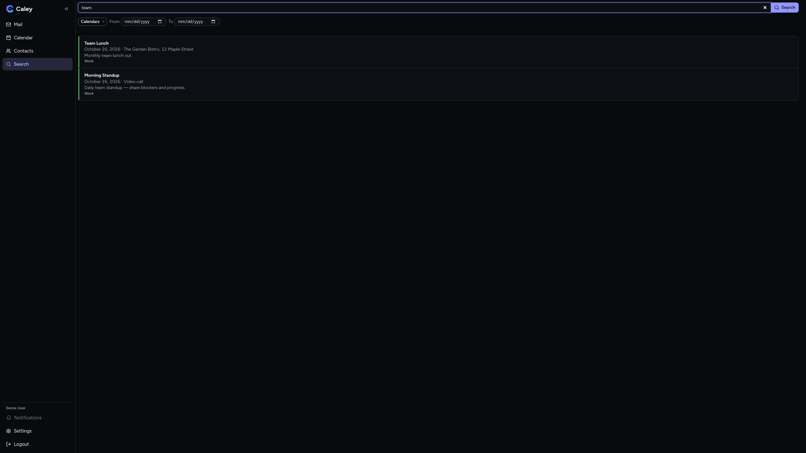

# Caley

Caley is a self-hosted personal groupware web app for calendars, contacts, email, and OpenPGP-assisted mail workflows.

It connects to existing CalDAV, CardDAV, IMAP, and SMTP servers, stores local cache data in SQLite, and serves a Svelte web UI from a Rust backend.

## Features

- Calendar: CalDAV calendar sync, active-calendar filtering, event creation/editing/deletion, recurring event overrides, ICS import/preview, full-text calendar search, live updates through SSE.
- Contacts: CardDAV addressbook sync, contact search/filtering, create/edit/delete contacts, contact photos, email/phone/address/org fields, map links for addresses.
- Email: IMAP accounts with autodiscovery, SMTP sending, multiple accounts and identities, mailbox browsing, unread counts, message threads, flags/read state, move/delete, attachments, export, virtual folders, full-text search, new-mail notifications.
- Privacy: remote email image allow/block controls and same-origin image proxying.
- OpenPGP: public key storage, trusted sender keys, private key import, encrypted synced private-key vault, WebAuthn/passkey unlock, device approval flow, encrypted/signed message display, signature verification, Autocrypt key discovery, and protected MIME compose paths.
- Authentication: direct CalDAV login is always available; OIDC login can be added with Pocket ID, Keycloak, Authelia, Authentik, or another OIDC provider.
- Storage: SQLite database plus cached mail files under the configured data directory. Stored CalDAV and IMAP passwords are encrypted at rest.

## Architecture

- **`backend/`** — Rust 2024 Axum server. Handles auth, CalDAV/CardDAV/IMAP/SMTP clients, SQLite persistence, encryption, sync tasks, WebAuthn/OpenPGP endpoints, SSE, and static frontend serving.
- **`frontend/`** — Vite + Svelte 5 static multi-page app. temper CSS (`@tiaforge-ui/temper`), Sass, TypeScript, and `@inlang/paraglide-js` i18n.

There is no root-level package manager or workspace. Run backend and frontend commands from their own directories.

## Requirements

- Rust toolchain with edition 2024 support.
- Node.js and npm for frontend development/builds.
- A CalDAV server for local login and calendar/contact setup.
- Optional: IMAP/SMTP account for email.
- Optional: OIDC provider for external authentication.
- Optional but recommended for PGP vault use: a PRF-capable passkey/WebAuthn authenticator and HTTPS origin.

## Configuration

All backend configuration is via environment variables. `backend/.env` is loaded automatically if present.

| Variable | Description | Required |
|---|---|---|
| `APP_BASE_URL` | Public URL of this app, for example `https://calendar.example.com` or `http://localhost:3000` locally. Also used for OIDC and WebAuthn origin setup. | Yes |
| `ENCRYPTION_KEY` | Passphrase used to derive the AES-256-GCM key for encrypted stored credentials. | Yes |
| `OIDC_ISSUER` | OIDC provider issuer URL. | Only for OIDC |
| `OIDC_CLIENT_ID` | OIDC client ID. | Only for OIDC |
| `OIDC_CLIENT_SECRET` | OIDC client secret. | Only for OIDC |
| `CALDAV_PORT` | Backend listen port. Default: `3000`. | No |
| `OIDC_LOGOUT` | Set to `false` to skip OIDC RP-initiated logout. Default: `true`. | No |
| `OIDC_USER_ID_CLAIM` | OIDC claim used as user ID: `sub`, `preferred-username`, `email`, or `name`. Default: `sub`. | No |
| `DATABASE_PATH` | SQLite database path. Default: `./data/caley.db`. | No |
| `STATIC_DIR` | Frontend dist directory. Default: `../frontend/dist`. | No |
| `SYNC_INTERVAL_MINS` | Background calendar/email sync interval. Default: `5`. | No |
| `SEARCH_MODE` | Full-text strategy: `default`, `trigram`, or a Snowball algorithm name such as `English` or `German`. Changing it rebuilds FTS indexes on startup. Default: `default`. | No |
| `MAP_URL` | Fallback map URL template. Use `{q}` for the URL-encoded query. Default: `https://www.openstreetmap.org/search?query={q}`. | No |
| `WEBAUTHN_EXTRA_ORIGINS` | Additional allowed WebAuthn origins. | No |

OIDC is enabled only when all three OIDC variables are set. If OIDC is enabled, register this redirect URI with the provider:

```text
{APP_BASE_URL}/auth/oidc
```

## Try It — Demo Mode

Demo mode lets you explore the full Caley UI without connecting to any external server (no CalDAV, no IMAP, no SMTP). It pre-seeds a realistic dataset so every part of the app has something to show.

### What's included

| Area | Data |
|---|---|
| Calendars | Work, Personal, Family — colour-coded |
| Events | ~16 seeds (recurring standups, appointments, vacation block, school events) expanding to 30+ occurrences |
| Contacts | 31 contacts with emails, phone numbers, and organisations |
| Email — Work account | 14 inbox messages (invoices, PRs, alerts, meeting notes), Sent, Archive, Junk |
| Email — Personal account | 8 inbox messages (bank statement, friend threads, newsletters), Sent |

Messages have styled HTML bodies. Unread/read state, flags, delete, and move all work locally. Compose returns success without sending.

### Showcase

#### Light theme

<p>
  <a href="https://git.tia.sh/tia/caley/raw/branch/main/docs/screenshots/caley-calendar.png"></a>
  <a href="https://git.tia.sh/tia/caley/raw/branch/main/docs/screenshots/caley-mail.png"></a>
</p>
<p>
  <a href="https://git.tia.sh/tia/caley/raw/branch/main/docs/screenshots/caley-compose.png"></a>
  <a href="https://git.tia.sh/tia/caley/raw/branch/main/docs/screenshots/caley-contacts.png"></a>
</p>
<p>
  <a href="https://git.tia.sh/tia/caley/raw/branch/main/docs/screenshots/caley-search.png"></a>
</p>

#### Dark theme

<p>
  <a href="https://git.tia.sh/tia/caley/raw/branch/main/docs/screenshots/caley-calendar-dark.png"></a>
  <a href="https://git.tia.sh/tia/caley/raw/branch/main/docs/screenshots/caley-mail-dark.png"></a>
</p>
<p>
  <a href="https://git.tia.sh/tia/caley/raw/branch/main/docs/screenshots/caley-compose-dark.png"></a>
  <a href="https://git.tia.sh/tia/caley/raw/branch/main/docs/screenshots/caley-contacts-dark.png"></a>
</p>
<p>
  <a href="https://git.tia.sh/tia/caley/raw/branch/main/docs/screenshots/caley-search-dark.png"></a>
</p>

### Run with Docker

```bash
docker run --rm -p 3000:3000 \
  -e DEMO_MODE=true \
  -e APP_BASE_URL=http://localhost:3000 \
  -e ENCRYPTION_KEY=demo-key \
  caley
```

Open `http://localhost:3000` and log in with any CalDAV URL and any username/password.

### Run locally

```bash
cd backend
DEMO_MODE=true APP_BASE_URL=http://localhost:3000 ENCRYPTION_KEY=demo-key cargo run
```

Open `http://localhost:3000`. Or start the Vite dev server alongside it for hot-reload:

```bash
cd frontend && npm install && npm run dev   # http://localhost:5173
```

### Notes

- Demo data lives in `./data/demo.db`, separate from the regular `caley.db`. Delete it to reset to the original seed data.
- Credential rows are re-encrypted on every startup, so you can freely change `ENCRYPTION_KEY` between runs.
- OIDC login and the WebAuthn/OpenPGP vault are not available in demo mode.

## Local Development

Start the backend:

```bash
cd backend
APP_BASE_URL=http://localhost:3000 ENCRYPTION_KEY=dev-secret cargo run
```

Start the frontend dev server in another terminal:

```bash
cd frontend
npm install
npm run dev
```

Open `http://localhost:5173`. The Vite dev server proxies `/api`, `/auth`, and `/logout` to `http://localhost:3000`.

Useful commands:

```bash
cd backend
cargo check
cargo test
cargo build --release
```

```bash
cd frontend
npm run build
npm run preview
npm test
```

## Running The Built App

Build the frontend:

```bash
cd frontend
npm install
npm run build
```

Run the backend and serve the built frontend:

```bash
cd backend
APP_BASE_URL=http://localhost:3000 ENCRYPTION_KEY=change-me cargo run
```

The backend serves `frontend/dist` by default. Use `STATIC_DIR` if the built frontend lives somewhere else.

## Docker

Build:

```bash
docker build -t caley .
```

Run with local CalDAV login only:

```bash
docker run -p 3000:3000 \
  -v caley-data:/data \
  -e APP_BASE_URL=https://calendar.example.com \
  -e ENCRYPTION_KEY=your-passphrase \
  caley
```

Run with OIDC also enabled:

```bash
docker run -p 3000:3000 \
  -v caley-data:/data \
  -e OIDC_ISSUER=https://auth.example.com \
  -e OIDC_CLIENT_ID=caley \
  -e OIDC_CLIENT_SECRET=secret \
  -e APP_BASE_URL=https://calendar.example.com \
  -e ENCRYPTION_KEY=your-passphrase \
  caley
```

Docker Compose example:

```yaml
services:
  caley:
    image: caley
    ports:
      - "3000:3000"
    volumes:
      - caley-data:/data
    environment:
      APP_BASE_URL: https://calendar.example.com
      ENCRYPTION_KEY: your-passphrase
      # Omit all three OIDC variables to use only CalDAV login.
      OIDC_ISSUER: https://auth.example.com
      OIDC_CLIENT_ID: caley
      OIDC_CLIENT_SECRET: secret

volumes:
  caley-data:
```

Persist `/data` or your configured `DATABASE_PATH` directory so SQLite data, cached mail files, sessions, credentials, and OpenPGP vault metadata survive restarts.

Podman works with the same build/run flags.

## Authentication Modes

CalDAV login is always available. Users log in with a CalDAV server URL, username, and password. Caley validates the credentials, derives a local user ID as `username@hostname`, stores the credentials encrypted, and starts a server-side session.

OIDC login is additive. When configured, the login page also shows the OIDC provider option. OIDC users configure CalDAV, email, and encryption settings after login.

## Data And Security Notes

- CalDAV and IMAP passwords are encrypted at rest using AES-256-GCM with a key derived from `ENCRYPTION_KEY` via HKDF-SHA256.
- OpenPGP private keys are stored through the encrypted vault flow and should only be decrypted client-side after WebAuthn unlock.
- Sessions are stored in SQLite and expire after 7 days of inactivity.
- The app does not terminate TLS. Put it behind Caddy, nginx, Traefik, or another reverse proxy for HTTPS.
- Use the public HTTPS URL as `APP_BASE_URL` in production, especially for OIDC and WebAuthn.

## Account Management

Users can delete their account from the settings page. This removes stored credentials, database-backed cached data, email metadata, contacts, calendar data, OpenPGP vault metadata, and flushes the current session.
